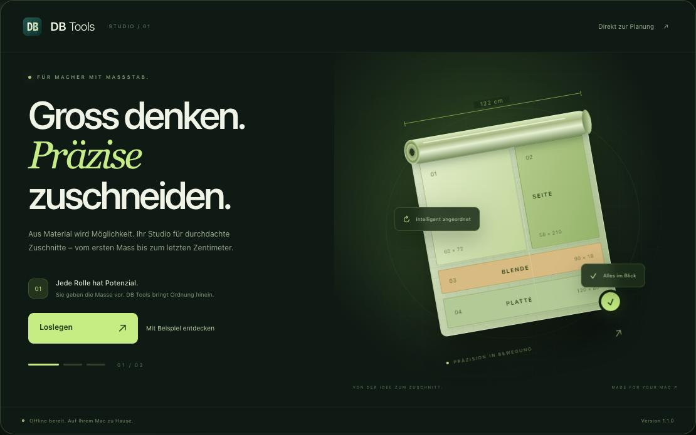

# DB Tools · 1.3.0

**Neu in 1.3.0** (erste stabile Version, ohne Beta-Kennzeichnung)

- **Zugabe pro Position:** Eigene Zugabe-Spalte pro Zeile, neue Positionen automatisch 3 cm pro Seite, „Zugabe für alle“ mit Rückgängig. Ältere Planungen werden ohne Ergebnisänderung übernommen.
- Design: breitere Eingabespalte, alle Kennzahlen sichtbar, ruhigere Reststück-Farben, ausgerichtete Felder.
- Fehlerbehebung: „Neu in DB Tools“ erscheint jetzt auch beim Update von 1.2.

- **Weniger Folienverbrauch:** Die Berechnung vergleicht jetzt hunderte Anordnungen (5 Platzierungsregeln × 7 Sortierungen, beide Drehrichtungen und eine reproduzierbare Verbesserungsphase) statt 15. In Tests nie schlechter, im Schnitt rund 1,7 % kürzer.
- **Meine Projekte:** Planungen mit Namen direkt in der App speichern, suchen, duplizieren, öffnen und löschen (mit Rückgängig). JSON-Dateien bleiben für Sicherungen verfügbar.
- **Schnittliste zum Abhaken:** Teile im Plan oder in der Liste anklicken, sobald sie geschnitten sind. Nummern im Plan zeigen die Reihenfolge vom Rollenanfang; der Fortschritt bleibt gespeichert.
- **Einfachere Eingabe:** Komma-Dezimalen (60,5), ganze Tabellen aus Excel/Numbers einfügen, Position duplizieren, Zusammenfassung der erfassten Teile, fehlerhafte Felder werden rot markiert.
- **Rückgängig** nach Löschen einer Position, „Leeren“, „Beispiel“ und „Neue Planung“.
- **Schnittfuge (mm)** als Abstand zwischen Teilen und **Materialkosten** über einen Preis pro Meter (CHF). Streifen unter 1 cm zählen als Verschnitt statt als Reststück.
- **Gleiche Farbe für gleiche Teile** mit Legende.
- **PDF sichern** (⇧⌘P) als Werkstattblatt: Projektname, Datum, Kennzahlen, Plan auf Seite 1 und Schnittliste mit Ankreuzfeldern auf Seite 2.
- Native Menüs: ⌘N Neue Planung, ⇧⌘O Meine Projekte, ⌘S Speichern, ⌘O/⇧⌘S Projektdatei, ⌘P Drucken.
- Nach einem Update zeigt DB Tools einmalig „Neu in DB Tools“.
- Bis zu 500 Zuschnitte pro Berechnung (vorher 200).

Bestehende Eingaben, Einstellungen und Projektdateien bleiben kompatibel. Interne Buildnummer: `1.3.999` (höher als `1.3.1` und `1.2.3`, Sparkle erkennt das Update).

Einfacher Zuschnittplaner für macOS mit Schwarz-Weiss-Oberfläche, Vollbildansicht und frei einstellbarer Zugabe pro Seite. Hell-, Dunkel- und Systemmodus bleiben verfügbar. Kein Feedback-Hub.


Siehe [Anleitung](ANLEITUNG.md).

---

# DB Tools Studio

Animierter Folien-Zuschnittplaner für macOS mit Hell-, Dunkel- und Systemmodus, drei Akzentfarben, Projektdateien, Planungsstandards und kostenlosen Sparkle-Updates über [GitHub Releases](https://github.com/UniverseMan12/DB_Tools/releases).



Die Zuschnittberechnung läuft vollständig lokal. Projekte lassen sich als JSON sichern und öffnen; Pläne als CSV, SVG oder PDF ausgeben. Die Einstellungen umfassen Darstellung, Bewegung, Dichte, Startverhalten, Standardmasse, Autospeicherung und Updates.

**Kein Apple-Abonnement für Updates erforderlich.** Sparkle prüft Update-ZIP und Appcast mit dem öffentlichen Ed25519-Schlüssel der App. Die fertigen App-Bundles werden kostenlos ad hoc signiert. macOS kann beim ersten Start eine manuelle Freigabe verlangen; Apple-Notarisierung ist nicht Bestandteil dieser Verteilung.

## Installieren und aktualisieren

DMG öffnen, **DB Tools** in **Programme** ziehen und von dort starten. Die Umstellung von Version 1.0.0 erfordert einmalig den Austausch der App. Danach aktualisiert Sparkle weitere Versionen über `UniverseMan12/DB_Tools`. App-Name, App-ID und lokaler Speicherort bleiben gleich.

Die ausführliche [Anleitung](ANLEITUNG.md) beschreibt Installation, Funktionen, den einmaligen GitHub-Secret-Schritt und spätere Veröffentlichungen. Der private Schlüssel gehört niemals ins Repository.

## Entwicklung

macOS und Node.js 24:

```sh
npm ci
node node_modules/electron/install.js
npm run icons
npm start
```

`npm test` prüft Berechnung, Projektvalidierung, Einstellungen und Updater-Anbindung. `npm run smoke` prüft die tatsächliche Oberfläche mit einem isolierten Profil und erzeugt Ansichten unter `qa/`. `npm run dist` baut die universelle DMG und ZIP unter `dist-free/`.

Für lokale Update-Signaturen: `SPARKLE_PRIVATE_KEY_FILE` setzen und `npm run appcast` ausführen. Für GitHub Actions einmal das Secret `SPARKLE_PRIVATE_KEY` mit dem separat gesicherten privaten Schlüssel anlegen. Anschliessend Versionsnummer erhöhen und einen passenden `v…`-Tag pushen oder den Workflow manuell starten. Der Workflow baut und signiert alles, lädt zuerst einen Release-Entwurf hoch und veröffentlicht ihn erst, wenn alle Dateien bereitliegen.

Die Test-App unter `qa-builds/` hat eine eigene App-ID und einen eigenen Datenordner. Sie wird nicht veröffentlicht. Der echte Update-Wechsel zwischen zwei Testversionen und der Datenerhalt wurden geprüft.

## Aufbau

- `app/index.html`, `app/studio.css`, `app/studio.js`: Oberfläche und Interaktionen.
- `app/preferences.js`: Theme-Start, Einstellungen und Projektvalidierung.
- `app/app.js`, `app/packing.js`: Zuschnittberechnung und Ausgaben.
- `electron/updates.cjs`: Sparkle-Anbindung ohne Apple-Developer-ID-Voraussetzung.
- `electron/update-config.json`: öffentlicher Schlüssel und GitHub-Feed.
- `scripts/build.cjs`, `scripts/appcast.cjs`: universeller Build und Signaturen.
- `.github/workflows/release.yml`: kostenlose Veröffentlichung im öffentlichen GitHub-Repository.

Maximal 200 Zuschnitte; heuristische Optimierung, kein garantiertes mathematisches Optimum. Masse vor dem Schneiden prüfen.
